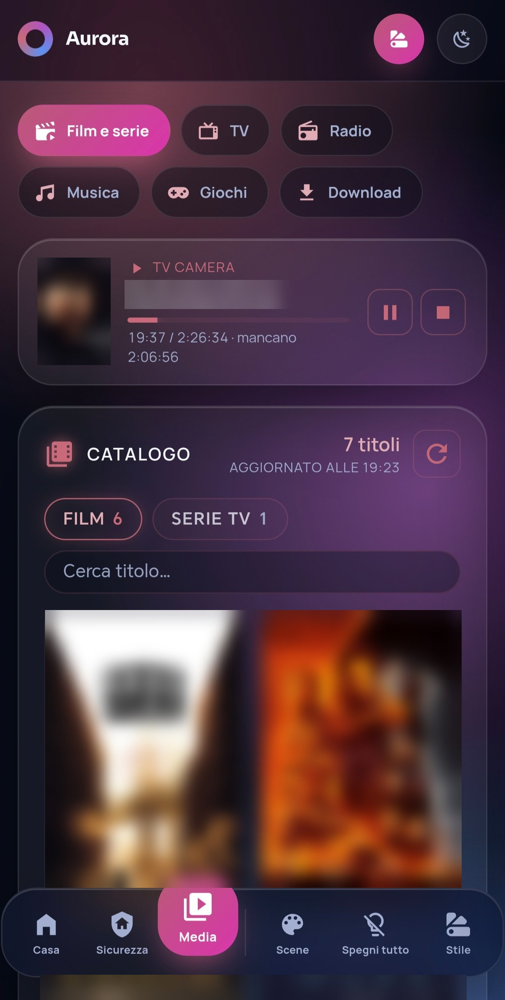
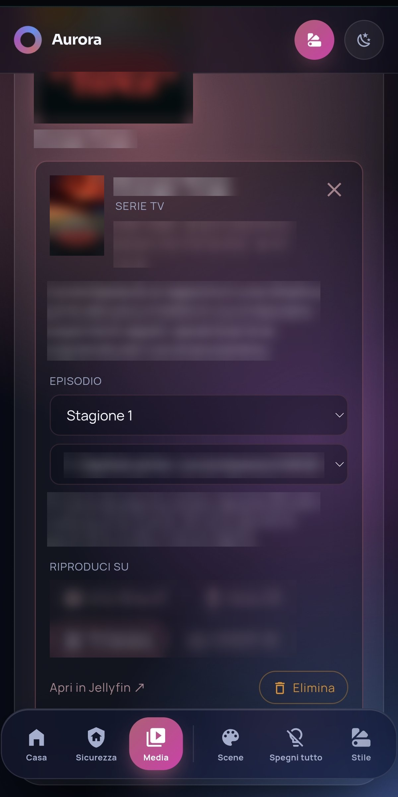
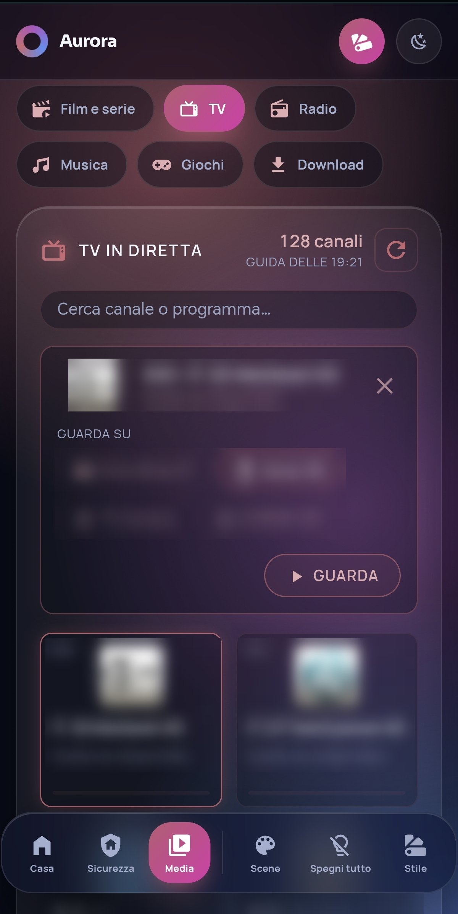
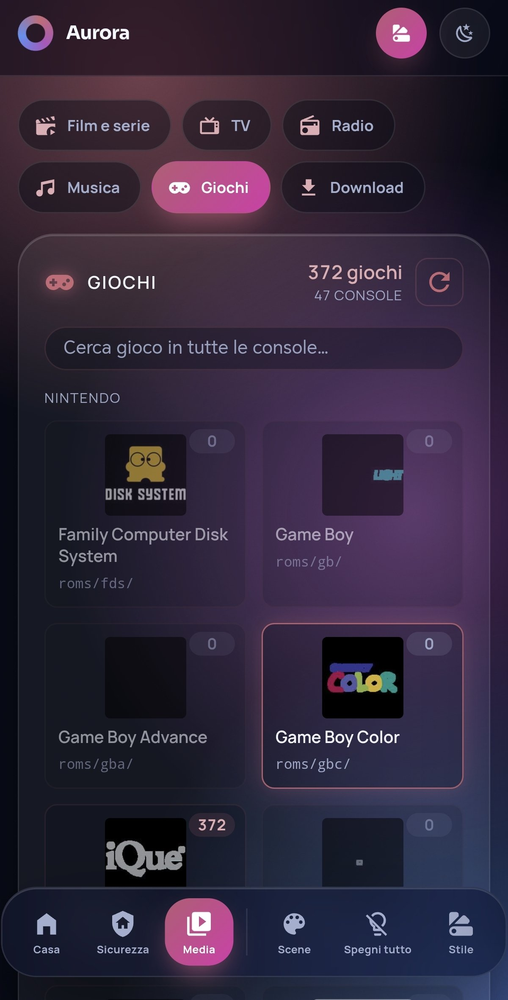
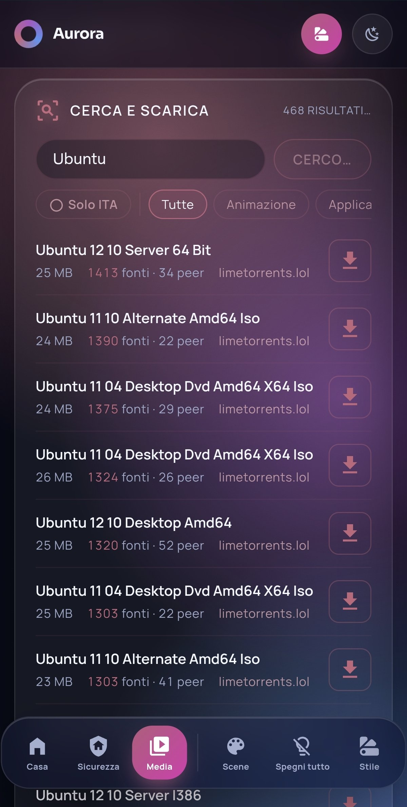
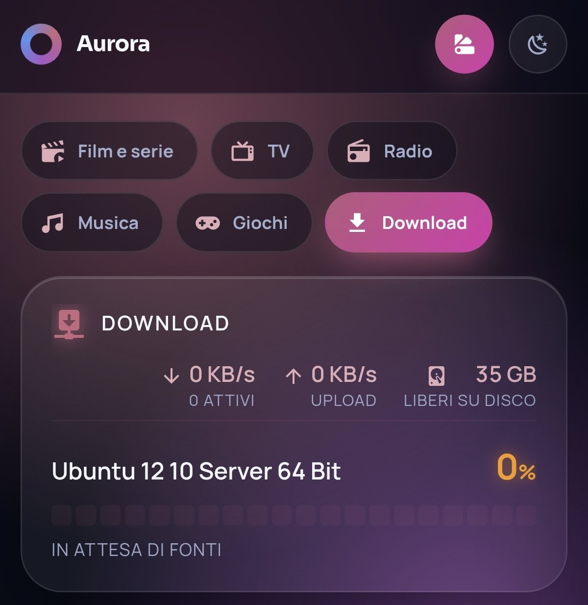
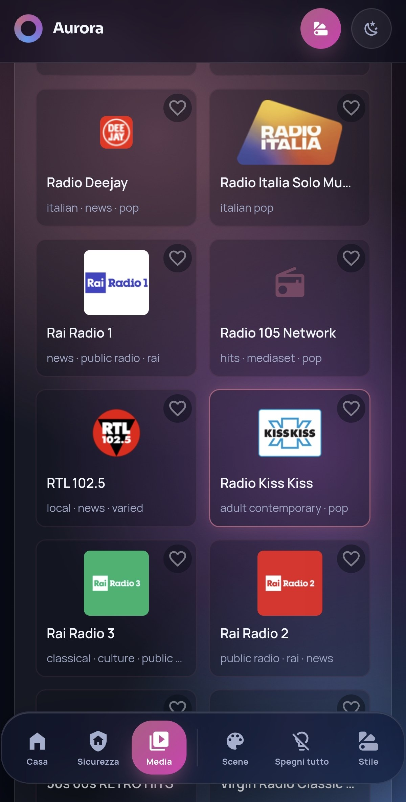
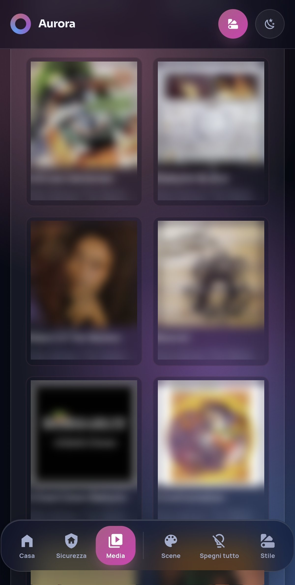

# ha-media-cards

Card per **Home Assistant** che trasformano una plancia in un centro multimediale di casa:
film e serie, TV in diretta, radio, musica e giochi retrò, da telefono, PC o display a muro.

Sono card "fatte in casa" (JavaScript puro, nessuna dipendenza), nate per il mio server domestico e
condivise così come sono. Testi dell'interfaccia in italiano.

  
  
  

  
  
  

  
  

Qui dentro la plancia Aurora Glass v3 (con <code>aurora-plus-card</code>); titoli, copertine e nomi dei dispositivi sono sfocati.

| Card | Cosa fa | Richiede |
|---|---|---|
| `media-catalog-card` | Catalogo film/serie con locandine, trama, voto; scelta stagione/episodio; **Riproduci** su un dispositivo; **Elimina** (opzionale) | Jellyfin + integrazione Jellyfin di HA |
| `jellyfin-now-card` | Cosa si sta guardando e dove, avanzamento, pausa/stop | Jellyfin |
| `livetv-card` | Canali TV con logo e programma in onda, avvio su un dispositivo | Live TV di Jellyfin |
| `radio-card` | ~1.500 radio italiane, ricerca, preferite per utente; suona nel browser, su Alexa o altri lettori | `scripts/radio_sync.py` |
| `music-card` | Album e artisti con copertine; ascolto nel browser (anche a schermo bloccato) o su un dispositivo | Jellyfin + `scripts/music_sync.py` |
| `romm-games-card` | Console divise per marca, giochi con copertine; "Gioca" nel browser | [RomM](https://github.com/rommapp/romm) + `scripts/romm_sync.py` |
| `qbit-search-card` | Ricerca con i plugin di qBittorrent, filtro per categoria e "solo ITA", scelta della cartella (Film, Serie TV › serie, Musica, Giochi) e avvio del download | qBittorrent con WebUI e plugin di ricerca |
| `aurora-plus-card` | Aggiunge una pagina **Media** alla barra della card [Aurora Glass v3](https://github.com/lucalux00/aurora-glass-v3), con dentro le card qui sopra | Aurora Glass v3 (non inclusa) |

## Installazione

1. Copiate i file di `cards/` in `/config/www/ha-media-cards/` di Home Assistant.
2. Impostazioni › Plance › ⋮ › **Risorse** › Aggiungi: `/local/ha-media-cards/<nome>-card.js`, tipo *Modulo JavaScript*.
   (In alternativa `scripts/carica_risorsa.py` carica la card come risorsa "inline", senza file in `www`.)
3. Aggiungete i comandi REST di [`examples/rest_commands.yaml`](examples/rest_commands.yaml) a `configuration.yaml`
   e la chiave API di Jellyfin in `secrets.yaml`.
4. Aggiungete le card alla plancia: esempi in [`examples/dashboard.yaml`](examples/dashboard.yaml).
5. Ricaricate la pagina (Ctrl+Shift+R; sul telefono chiudete e riaprite l'app).

### Perché le copertine passano da `/local`

Se aprite HA da fuori casa (Nabu Casa, HTTPS), il browser non carica immagini da `http://<ip-locale>`.
Gli script in `scripts/` copiano copertine e loghi in `/config/www/...`, così HA li serve da sé e si vedono ovunque:

| Script | Dove gira | Per quale card |
|---|---|---|
| `jellyfin_posters.py` | dentro il container HA (`docker exec`) | media-catalog-card |
| `jellyfin_livetv_logos.py` | dentro il container HA | livetv-card |
| `radio_sync.py` | dentro il container HA | radio-card |
| `romm_sync.py` | dentro il container HA | romm-games-card |
| `music_sync.py` | sull'host (python3, solo libreria standard) | music-card |

Le istruzioni sono in cima a ogni file; le impostazioni (indirizzi, cartelle) si passano con variabili d'ambiente.
Lanciateli con `cron` (es. una volta al giorno per le radio, ogni pochi minuti per giochi e musica).

### Far partire un film sulla TV

Le card mandano il titolo a qualunque lettore Jellyfin acceso. Per una TV che deve prima accendersi e aprire l'app,
si indica nella card uno **script** (`devices: [{ name, script }]`) che riceve `media_id` e `media_type`:
un esempio per TV LG webOS è in [`examples/script_tv.yaml`](examples/script_tv.yaml).

Nota per le TV LG: l'app Jellyfin di webOS apre **due** sessioni e i comandi arrivano solo a una delle due,
non sempre la stessa. Per questo lo script e `jellyfin-now-card` mandano i comandi a tutte le sessioni del dispositivo.

### Pulsante Elimina

`media-catalog-card` e `music-card` possono cancellare un titolo **dal disco** (tramite Jellyfin) e togliere il torrent
da qBittorrent. Le cartelle delle librerie sono impostate in cima a `media-catalog-card.js`
(`MCC_JF_ROOT`, `MCC_QB_ROOT`, `MCC_LIB_DIRS`; per la musica `MC_JF_ROOT`, `MC_QB_ROOT` in `music-card.js`): adattatele ai vostri percorsi prima di usarlo. Se non vi serve,
non aggiungete i rest_command `jellyfin_elimina` / `qbittorrent_*`.

## Uso dei contenuti

Questi strumenti sono pensati per contenuti di cui avete i diritti: copie personali dei vostri film e dischi,
musica acquistata, canali TV gratuiti e ufficiali, ROM dei giochi che possedete o giochi liberi (homebrew).

## Licenza

[MIT](LICENSE) © 2026 scimokitazawa. Aurora Glass v3 è di un altro autore (GPL-3.0) e non è inclusa.
Le card sono state scritte con l'aiuto di un'intelligenza artificiale (Claude).
